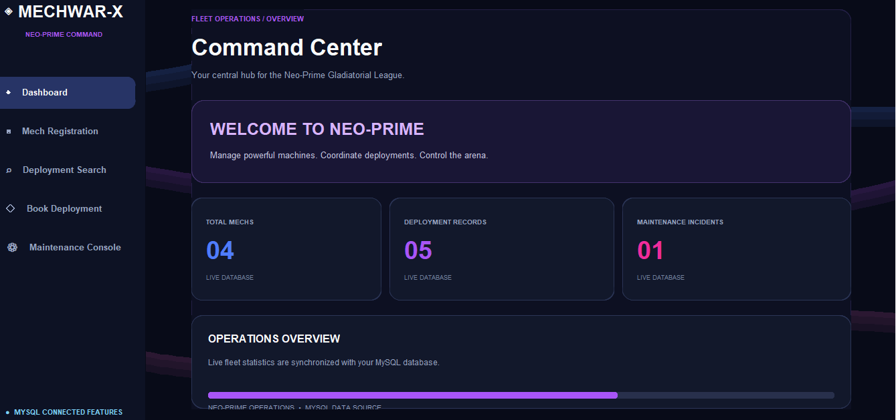
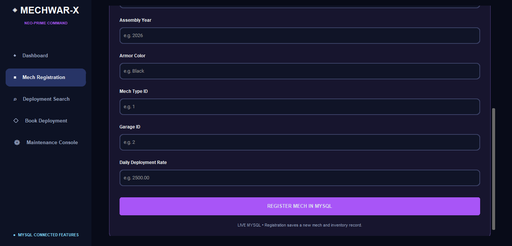
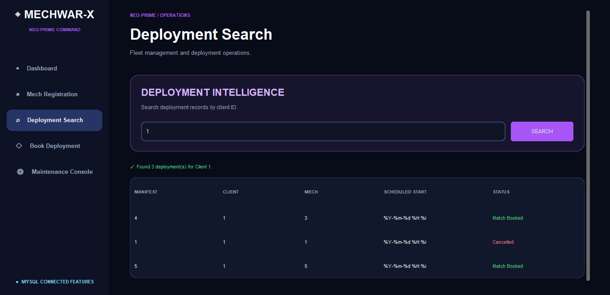
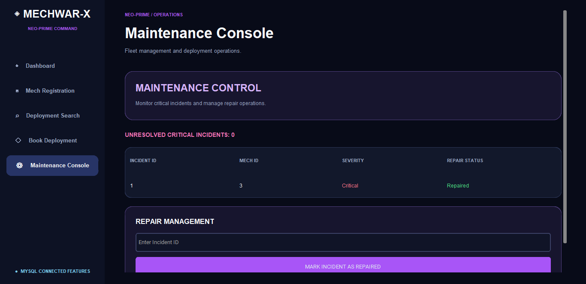

# ◈ MechWar-X | Neo-Prime Command

**A neon-styled desktop command center for managing a futuristic mech fleet.**

MechWar-X is a database-driven desktop application created for an FIU database systems group project. It combines a **Python / CustomTkinter** interface with a **MySQL 8** relational database to manage machine registration, deployment schedules, and maintenance records.

## Live dashboard



*Live MySQL dashboard showing the fleet overview, deployment records, and maintenance incidents.*

### At a glance

| Area | What it does |
| --- | --- |
| **Command Center** | Displays live counts of registered mechs, deployment manifests, and maintenance incidents |
| **Mech Registration** | Validates mech specifications and inserts records into `Mech` and `MechInventory` in one transaction |
| **Deployment Search** | Retrieves real deployment manifests for a specified client |
| **Deployment Booking** | Calls the database's `BookDeployment` stored procedure to create a booking |
| **Maintenance Console** | Lists incidents and updates unresolved repairs |
| **Visual design** | Dark neon interface with blue, purple, and pink aurora animation |

## Interface

The application includes five sidebar screens: **Dashboard**, **Mech Registration**, **Deployment Search**, **Book Deployment**, and **Maintenance Console**.

### Mech Registration

Capture and validate mech specifications, including manufacturer, model, assembly year, mech type, garage, and deployment rate.



### Deployment Search

Look up deployment manifests by client and review scheduled start times and booking statuses pulled from MySQL.



### Maintenance Console

Review incident severity, repair status, and unresolved critical maintenance items.



*All screenshots are from the desktop application; the registration screenshot shows the lower portion of its scrollable form.*

## Tech stack

- **Language:** Python 3
- **Desktop GUI:** CustomTkinter + Tkinter
- **Database:** MySQL 8
- **Database driver:** mysql-connector-python
- **Configuration:** python-dotenv
- **Architecture:** UI (`main.py`) → database operations (`mechwarx_operations.py`) → connection utility (`db_connection.py`) → MySQL

## Repository files

```text
MechWar-X/
├── main.py                 # Desktop GUI and screen navigation
├── mechwarx_operations.py  # Registration, search, booking, and repairs
├── db_connection.py        # MySQL connection and dashboard counts
├── requirements.txt        # Python dependencies
├── sql/                    # Clean schema, procedures, triggers, and demo seed
├── screenshots/            # Screenshots from the running application
├── CONTRIBUTING.md         # Group collaboration guide
├── .env.example            # Placeholder database settings
└── .gitignore              # Excludes credentials and local files
```

## Run locally

**Prerequisites:** Python 3, a running MySQL 8 server, and a database named `MechWarX` with the expected tables and stored procedures.

1. Clone the repository:

   ```bash
   git clone https://github.com/abtahac-hue/MechWar-X.git
   cd MechWar-X
   ```

2. Install the required packages:

   ```bash
   python -m pip install -r requirements.txt
   ```

3. Copy `.env.example` to `.env`, then fill in **your own local MySQL credentials**:

   ```dotenv
   DB_HOST=127.0.0.1
   DB_PORT=3306
   DB_USER=your_mysql_user
   DB_PASSWORD=your_mysql_password
   DB_NAME=MechWarX
   ```

4. **Initialize a new, empty development database** using MySQL Workbench. Open and execute these files **in this order**, one at a time:

   | Order | File | Purpose |
   | --- | --- | --- |
   | 1 | [`sql/01_schema.sql`](sql/01_schema.sql) | Create the database and all eight related tables |
   | 2 | [`sql/02_book_deployment.sql`](sql/02_book_deployment.sql) | Add booking validation, transaction, and overlap checks |
   | 3 | [`sql/03_maintenance_triggers.sql`](sql/03_maintenance_triggers.sql) | Keep critical-maintenance availability in sync |
   | 4 | [`sql/04_deployment_lifecycle.sql`](sql/04_deployment_lifecycle.sql) | Add cancel, start, and complete routines |
   | 5 | [`sql/05_demo_seed.sql`](sql/05_demo_seed.sql) | **Optional:** insert fictional example records |

   **Do not execute setup scripts against an existing populated database.** These scripts are intended for a first-time installation. They haven't yet been verified end-to-end on a separate clean MySQL instance.

5. Start the desktop app:

   ```bash
   python main.py
   ```

> **Note:** The dashboard needs MySQL to be running. Registration, booking, and repair actions write to the database. Work against a development database and back it up before testing changes.

## Database design

The application works with the following related tables:

`MechType` · `BattleGarage` · `Mech` · `MechInventory` · `Client` · `DeploymentManifest` · `MaintenanceIncident` · `PitCrewTechnician`

Key database features include foreign-key relationships, transactional registration, stored-procedure-driven deployment booking, and maintenance state updates.

## Team collaboration

See [CONTRIBUTING.md](CONTRIBUTING.md) for branch-based contributions, testing expectations, and safe handling of local database files. Each collaborator should configure their own MySQL development database and local `.env`.

## Testing status

The application has been launched locally with MySQL connected. The dashboard, deployment search, maintenance incident listing, registration, and a successful deployment booking have been exercised manually.

**Still to verify:** rejection of an overlapping second booking, updating a currently unresolved incident, automated tests, and a clean-machine installation.

## Security

- `.env` is excluded from Git and must never be committed.
- Raw MySQL `.ibd` files, local database backups, and Python caches are excluded.
- The included `.env.example` contains placeholders only.
- SQL scripts contain fictional `.example` contact addresses, not real credentials or personal customer records.
- The `sql/` setup files intentionally exclude the original coursework's destructive/duplicate-entry test statements.
- Use the principle of least privilege when creating a local MySQL account.

## Academic project

Built as an **FIU database systems group project** and developed as a portfolio demonstration of relational database design, desktop application integration, validation, and data-driven user interfaces.
